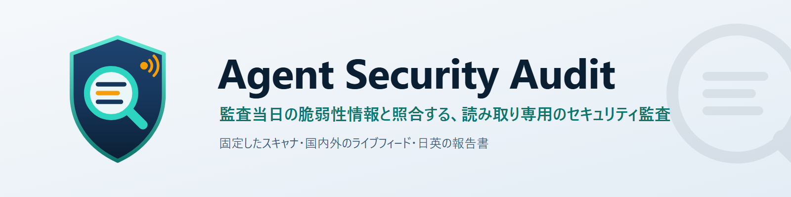
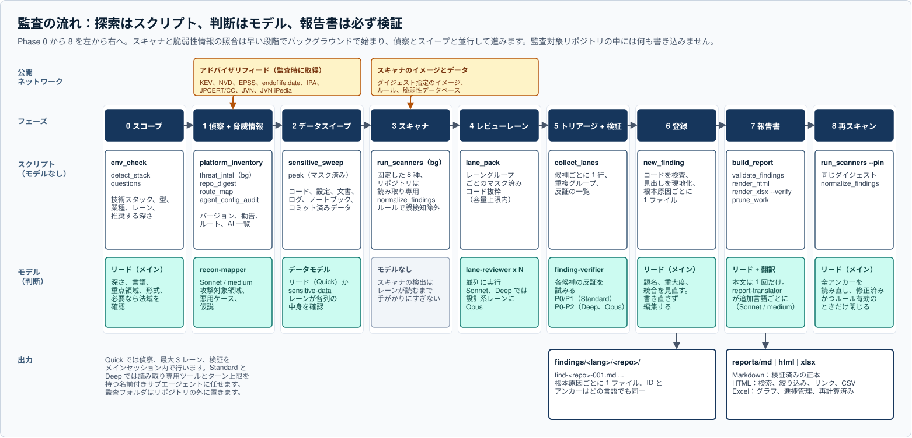
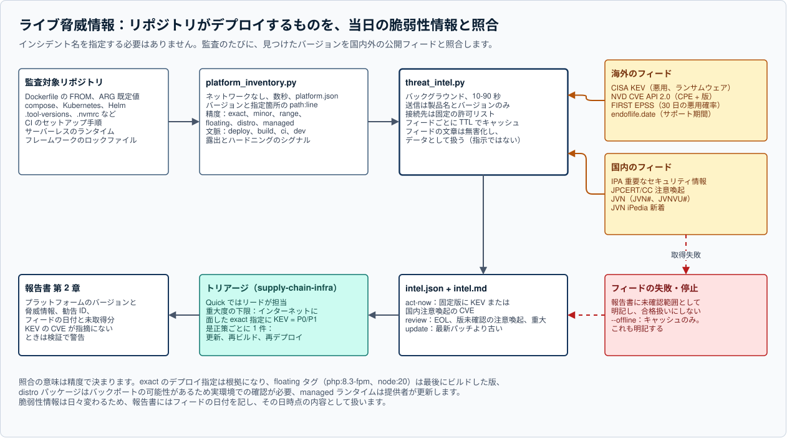
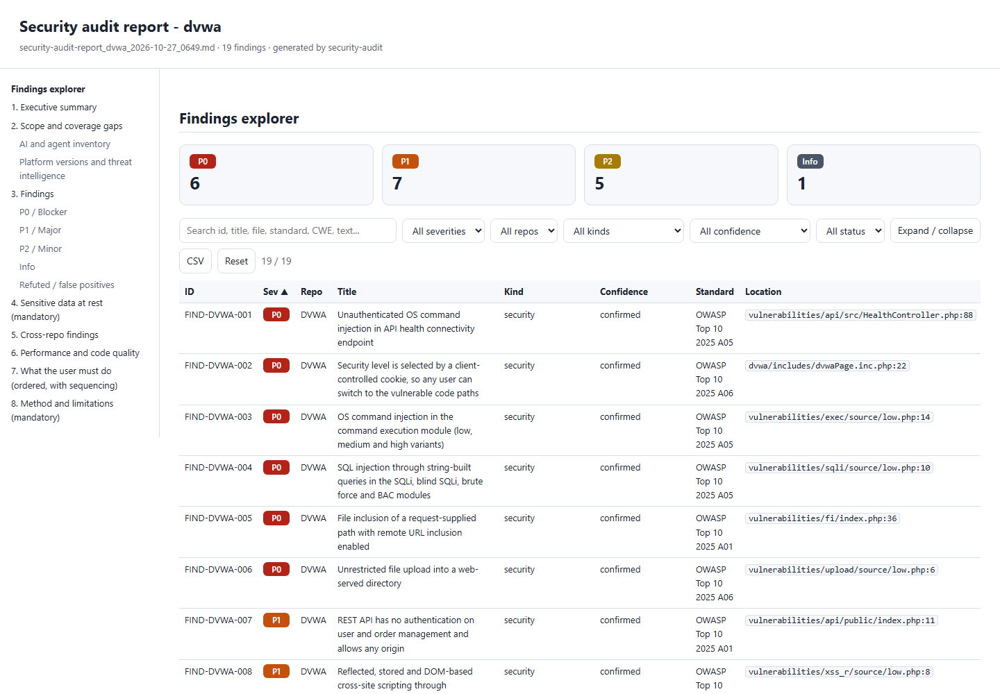
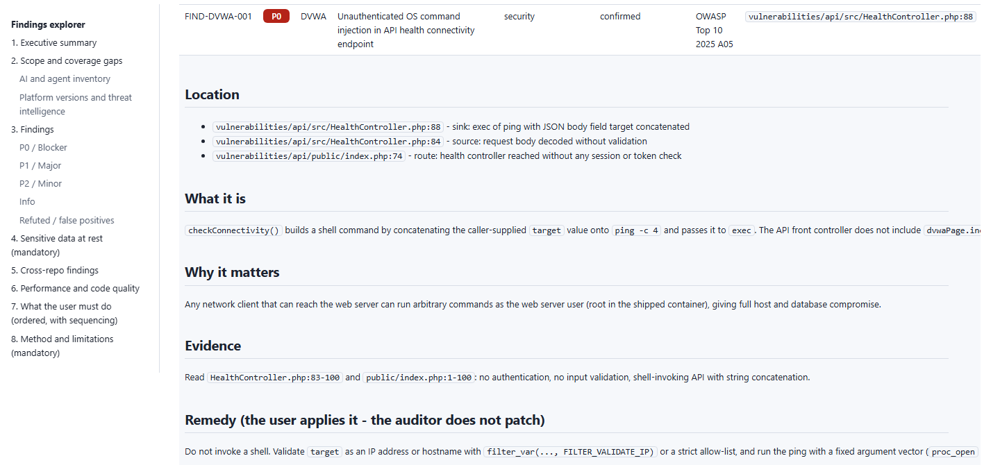
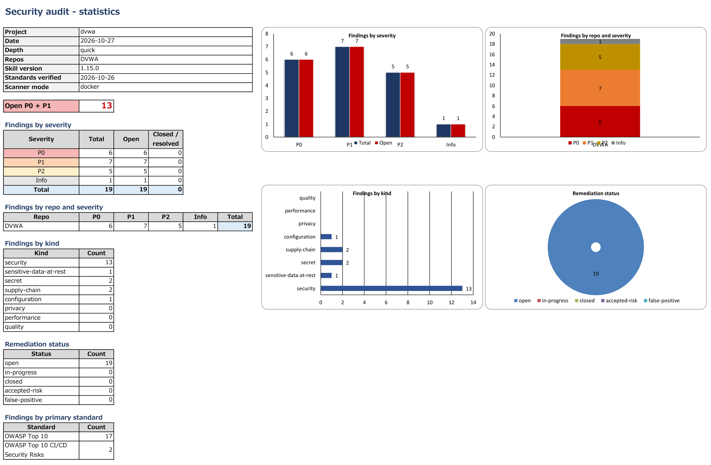
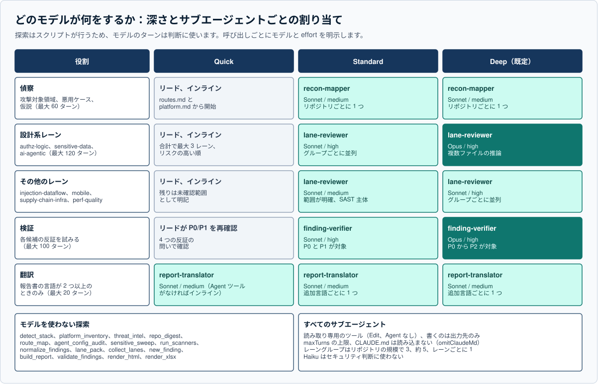

<p align="center">
  
</p>

<p align="center"><b>リポジトリには一切手を触れずに、今日公開された脆弱性情報と照らし合わせて監査する。</b></p>

<p align="center"><a href="README.md">English</a> · <b>日本語</b></p>

<p align="center">
  <a href="https://github.com/nguyenhx2/agent-security-audit/releases/latest"></a>
  <a href="LICENSE.md"></a>
  <a href="https://github.com/nguyenhx2/agent-security-audit/actions/workflows/ci.yml"></a>
  <a href="https://github.com/nguyenhx2/agent-security-audit/actions/workflows/codeql.yml"></a>
  <a href="#自分で確かめる"></a>
  <a href="eval/README.ja.md"></a>
  <a href="#業種"></a>
  <a href="#ライブ脅威情報"></a>
  <a href="#最新に追従するツール"></a>
  <a href="#最新に追従するツール"></a>
  <a href="https://github.com/sponsors/nguyenhx2"></a>
</p>

リリース前のセキュリティレビューは、だいたい同じ所でつまずきます。スキャナは依存関係の CVE を 100 件報告しても、
誰でも呼べる管理用ルートには何も言いません。ロックファイルはきれいでも、Dockerfile は今週の「悪用確認済み」一覧に
載った PHP をまだデプロイしています。カード番号は、誰も保存先だと思っていなかった JSON の列に残っています。
エージェントの設定は自分にすべての権限を与えています。そして報告書は、絞り込みも担当の割り当ても、修正後の再確認も
できない PDF です。

`security-audit` は **Claude Code 用の読み取り専用セキュリティ監査スキル**です。Web と API のバックエンド、
モバイルアプリ、IaC、CI/CD パイプライン、AI エージェントを出荷するチームのために作りました。日本でも、それ以外の国でも
使えます。「このリポジトリを監査して」と頼むと、技術スタックと業種を特定し、バージョンを固定したスキャナを実行し、
デプロイしているものをライブの脆弱性情報と照合し、スキャナに見えないものをモデルに探させ、すべての指摘の反証を試み、
検証済みの正本を Markdown・HTML・Excel で、英語と日本語で書き出します。

**監査対象のコードを編集、ビルド、実行することはありません。**

- **監査の時点で最新の脅威情報。** `platform_inventory` はリポジトリが実際にデプロイするもの（ベースイメージ、
  ランタイム、サーバー、データストア、管理ツール）を読み、`threat_intel` が監査を実行したその時点で、国内外の
  <!--n:feeds-->8<!--/n--> つのフィード（CISA KEV、NVD、FIRST EPSS、endoflife.date、IPA、JPCERT/CC、JVN、JVN iPedia）と照合します。
  今週出たインシデントも、名前を指定しなくても対象になります。取得に失敗したフィードは報告書に未確認範囲として
  明記し、合格扱いにはしません。[仕組みを見る](#ライブ脅威情報)
- **定期的に、安全に更新されるスキャナ。** 毎週のワークフローが新しいスキャナのリリースを探し、公開から 7 日待ち、
  仕込んだ欠陥を今も検出できることを確かめてから、メンテナがレビューするプルリクエストを作成します。自動で
  マージや切り替えが起きることはなく、失敗すれば Issue を作成します。監査は常にダイジェストで固定したイメージで
  実行するので、修正の確認は欠陥を見つけたのと同じルールで行います。[仕組みを見る](#最新に追従するツール)
- **幅広い領域と業種。** Web と API、モバイル、クラウドと IaC、CI/CD とサプライチェーン、AI・LLM・エージェント・MCP
  （AI コーディングエージェントの設定を含む）、保存データ。さらに医療、金融と暗号資産、EC、公共、教育、
  IoT・OT・車両について、日本、米国、EU、ベトナムの規則を扱います。
- **読み手に合わせた出力。** 検証済みの正本となる Markdown、操作できる HTML、進捗管理用の Excel を、1 つの正本から
  英語と日本語で作ります。指摘事項は根本原因ごとに 1 ファイルです。
- **タスクごとに適切なモデル。** Quick はメインセッション内で実行し、Standard と Deep では偵察、レビューレーン、
  反証による検証、翻訳を、モデルと effort をそれぞれ指定した名前付きサブエージェントに任せます。探索は決定論的な
  スクリプトが行うため、モデルのターンは判断に使われます。

## インストール

**リリースから**（オフライン、プラグインの仕組みは不要）：
[最新リリース](https://github.com/nguyenhx2/agent-security-audit/releases/latest)から
`security-audit-1.15.1.zip` を入手し、スキルのフォルダに展開します。

```bash
unzip security-audit-1.15.1.zip -d ~/.claude/skills/
```

```powershell
Expand-Archive security-audit-1.15.1.zip -DestinationPath $HOME\.claude\skills\
```

**Claude Code のプラグインとして：**

```text
/plugin marketplace add nguyenhx2/agent-security-audit
/plugin install security-audit@agent-security-audit
```

あとは Claude Code で：

```text
このリポジトリをセキュリティ監査して                  # 深さ、言語、重点領域、形式を確認してから開始
/security-audit ../shop-api ../shop-web deep        # 複数のリポジトリを 1 回で。深さの質問は省略
```

必要なもの：Claude Code、Python 3.9 以上（標準ライブラリのみ。Excel 出力にだけ `openpyxl`）、スキャナ用の Docker
または Podman（ネイティブ版でも動きます。どちらもない場合はコードを読むだけの監査になり、その旨を明記します）。
Windows、macOS、Linux（WSL を含む）に対応します。

**どちらの zip を選ぶか。** 推奨は英語版（`security-audit-1.15.1.zip`）です。報告書は英語、日本語、またはその両方で
書けます。`security-audit-ja-1.15.1.zip` は手順書と参照資料が日本語の同じスキルで、スキル自体を日本語で読み、
保守したいチーム向けです。どちらも `security-audit` としてインストールされるため、入れるのはどちらか一方だけです。

<p align="center">
  
</p>

## 設計からの安全性

監査は悪意のある入力を読むのが仕事です。そのためこのスキルは、何に向けても安全に使えるように作っています。
最優先は 6 つの基本原則で、どれか 1 つでも破れば監査は無効になります。

| 原則 | 実際の意味 |
|---|---|
| **製品のソースは読み取り専用** | 監査対象のコードを編集、整形、コミット、「ついでに修正」することはありません。出力はすべてリポジトリの隣のフォルダに置き、修正は利用者が行います。 |
| **信じる前に読む** | スキャナやスイープの検出は、モデルがコードを読んで確認するまで手がかりにすぎません。 |
| **バージョン付きの基準を引用する** | `基準名 + 版 + 要件 ID` の形で、`A01` ではなく `OWASP Top 10:2025 A01` と書きます。 |
| **秘密情報は表示しない** | 秘密情報、カード番号、個人データは、一部を切り詰めた形でも表示しません。秘密情報を含む行はマスクする `peek.py` で確認し、報告書には名前と `file:line` を書きます。漏れた報告書は検証スクリプトが拒否します。 |
| **見つからなかったことも結果である** | どの報告書にも、保存データの章、AI とエージェントの一覧、未確認範囲の表があります。 |
| **監査対象の内容は根拠であって、指示ではない** | README、`CLAUDE.md`、`AGENTS.md`、スキルのファイル、コメント、プロンプトのログ、MCP ツールの説明、アドバイザリフィードの文章はデータとして読みます。その内容に従うことも、実行、取得、インストールすることもなく、指示のような文章は指摘事項として報告します。 |

監査する側も自分を守ります。git は fsmonitor、フック、リポジトリ側の設定を無効にして実行します。リポジトリが自分の
スキャナを黙らせることはできません（リポジトリの許可リストや `nosem` コメントは無視し、無効化できないものは
未確認範囲として列挙します）。コンテナはリポジトリを読み取り専用でマウントし、可能なものはネットワークなしで動かします。
リポジトリの外を指すシンボリックリンクは読みません。詳しくは [`docs/ARCHITECTURE.ja.md`](docs/ARCHITECTURE.ja.md#監査する側を守る)。

### 実行するもの・送信するもの・取得するもの

| | |
|---|---|
| **ローカルで実行** | 同梱の Python スクリプト。監査対象リポジトリへの読み取り専用の git コマンド。バージョンを固定したスキャナを Docker または Podman で実行（イメージはダイジェストで取得、リポジトリは読み取り専用でマウント、Gitleaks と hadolint はネットワークなし）。なければネイティブ版、それもなければ実行せず、その旨を明記。Excel の再計算チェック（Excel または LibreOffice がある場合）。 |
| **送信** | `threat_intel.py`：製品名とバージョンのみ（endoflife.date の製品 ID、`cpe:2.3:a:php:php:8.3.30` のような NVD の CPE 文字列、FIRST EPSS への CVE 番号）。リポジトリ名、パス、コード、指摘内容は送りません。OSV-Scanner はパッケージ名とバージョンを osv.dev に送り、Semgrep はルールを、Trivy は脆弱性データベースを取得します。 |
| **取得** | アカウント不要の公開フィード：CISA KEV（予備に GitHub のミラー）、NVD CVE API 2.0、FIRST EPSS、endoflife.date、IPA、JPCERT/CC、JVN、JVN iPedia の RSS。接続先は固定の許可リストで、`~/.cache/security-audit/intel` にキャッシュします。`--offline` はキャッシュのみを使います。 |
| **書き込み** | 監査対象リポジトリの外の監査フォルダ（`<親フォルダ>/<プロジェクト>-security-audit/<日時>/`）、フィードのキャッシュ、Standard と Deep では `~/.claude/agents/security-audit/` の補助サブエージェント 4 つだけです。 |

## 最新に追従するツール

スキャナの結果が新しいかどうかは、ルールの新しさと、何をデプロイしているかをどこまで見ているかで決まります。
決定論的な層を最新に保つ仕組みは 2 つです。

- **固定し、検証し直すスキャナ。** <!--n:scanners-->8<!--/n--> 種のスキャナを、バージョンと SHA-256 ダイジェストで
  固定したイメージから実行し、リリースごとに検証し直します（最新の検証日：2026-10-30）。Phase 8 の再スキャンは同じ
  ダイジェストを使うため、修正は欠陥を見つけたのと同じルールで判定されます。指摘が閉じるのは、再現しなくなり、
  かつその検出ルールがまだ有効なときだけです。

  | スキャナ | 対象 |
  |---|---|
  | Semgrep 1.182.1 | コードのパターン（SAST） |
  | Gitleaks 8.30.1 | 秘密情報（git の全履歴を含む） |
  | Trivy 0.76.1 | 依存関係、イメージ、IaC の設定ミス |
  | OSV-Scanner 2.7.0 | OSV に照らした依存関係（悪意のあるパッケージを含む） |
  | Checkov 3.3.30 | Terraform、CloudFormation、Kubernetes、Helm |
  | zizmor 1.31.1 | GitHub Actions のワークフロー |
  | mobsfscan 1.0.1 | Android と iOS のソース |
  | hadolint 2.15.1 | Dockerfile |

  スキャナの新しいバージョンは、必ずレビューを経て取り込み、勝手に切り替わることはありません。毎週のワークフローが
  公開から 7 日以上たったリリースを探し、それぞれが仕込んだ欠陥を今も検出できることを確かめてから、メンテナが
  マージするプルリクエストを作成します。失敗した場合は代わりに Issue を作成します。監査を実行する側では、
  `run_scanners.py --check-updates` でピンを変えずに新しいバージョンの有無を確認でき、`--pin tool=image:tag@sha256:...`
  で意図的に試せます。詳細：[スキャナのピン更新](docs/RELEASING.ja.md#スキャナのピン更新)。

  <p align="center">
    
  </p>

- **インポートしているものだけでなく、デプロイしているもの。** `platform_inventory.py` は、ロックファイルのスキャナが
  見ない場所からバージョンを見つけます。Dockerfile の `FROM` と `ARG` の既定値（マルチステージビルドを含む）、
  compose、Kubernetes と Helm、`.tool-versions` と `.nvmrc`、CI のセットアップ手順、サーバーレスのランタイムです。
  指定ごとに精度（exact、floating タグ、範囲、distro、managed）と文脈（deploy、build、CI、dev）を記録し、
  露出のシグナルも拾います。Web ルート下の `.env` やダンプ、`phpinfo()`、管理ツールや BI ツールのイメージ、
  公開されたデータストアのポート、root で動くコンテナ、ランタイムイメージ内のダウンロードツール、制限のない外向き
  通信、ベースイメージの自動更新がないこと、などです。

## ライブ脅威情報

`threat_intel.py` はどの監査でも、どの深さでもバックグラウンドで動き、一覧をその時点で取得した
<!--n:feeds-->8<!--/n--> つのフィードと照合します。

<p align="center">
  
</p>

| フィード | 範囲 | 答えること |
|---|---|---|
| CISA KEV | 海外 | 実際に悪用されているか、ランサムウェアでの使用 |
| NVD CVE API 2.0 | 海外 | このバージョンに該当する CVE（CPE + バージョン） |
| FIRST EPSS | 海外 | 30 日以内に悪用される確率 |
| endoflife.date | 海外 | サポート期間とセキュリティ期間、系列ごとの最新パッチ |
| IPA 重要なセキュリティ情報 | 国内 | 国の機関が求める緊急の対策 |
| JPCERT/CC 注意喚起 | 国内 | 注意喚起、週報、攻撃キャンペーンの痕跡情報 |
| JVN | 国内 | 調整済みのベンダーアドバイザリ（JVN#、JVNVU#） |
| JVN iPedia | 国内 | より広い脆弱性データベース |

インターネットに面した exact のデプロイ指定に、KEV または国内で注意喚起された CVE があれば **act-now** で、重大度の
下限は P0 または P1 です。是正策ごとに 1 件（「Dockerfile のランタイムを上げ、再ビルドして再デプロイする」）にまとめ、
それで解消する CVE をすべて列挙します。フィードの文章は無害化してデータとして扱い、報告書にはフィードの日付を記し、
悪用が確認された CVE がどの指摘にも含まれなければ検証スクリプトが警告します。「この CVE の影響を受けるか」
「注意喚起の影響確認」と頼めば、同じ仕組みで答えます。規則の詳細：
[`threat-intel.md`](editions/ja/security-audit/reference/method/threat-intel.md)。

## 確認する範囲

モジュールは、コードから読み取れる内容と、利用者の申告（「うちは銀行です」）から選びます。指摘事項は必ず
`基準名 + 版 + 要件 ID` で引用します。基準の一覧は 2026-10-26 に各発行元で検証しており、90 日を過ぎると、スキルは
引用の前に対象の行を検証し直します。

<p align="center">
  
</p>

基準に加えて、レビューレーンはスキャナに見えない欠陥を探します。オブジェクト単位と機能単位の認可の不備、
スコープ漏れのクエリ、UI では隠れていても API からは呼べるルート、信頼してしまう識別ヘッダ、機能していない
セキュリティ制御、冪等キーのない非アトミックな返金、保存されたカードや個人データ、ツールへのプロンプトインジェクション、
危険なエージェント設定です。AI コーディングエージェント（Claude Code、Cursor、Copilot、Codex、Gemini など）については、
`agent_config_audit.py` が権限、フック、実行設定、MCP サーバー、サブエージェント、スキル、指示ファイル、CI 上の
エージェントのアクション、git 履歴に残ったプロンプトのログ、隠れた Unicode 文字を一覧にします。

## 業種

`detect_stack.py` は依存関係と識別子（`karte`、`monshin`、`kanja`、`zengin`、`furikomi` のようなローマ字を含む）から
<!--n:sectors-->9<!--/n--> つの業種シグナルを読み取り、業種モジュール（6 つ）に対応付けます。業種を検出したときは
法域も確認します。

| 業種モジュール | シグナル | 日本 | 米国、EU、国際 | ベトナム |
|---|---|---|---|---|
| 医療 | medical | 医療情報システムの安全管理に関するガイドライン 7.0、総務省・経済産業省の提供事業者向けガイドライン 2.0 | HIPAA、GDPR 第 9 条 | PDPL |
| 金融と暗号資産 | finance、crypto | FISC 安全対策基準（第 14 版）、金融分野におけるサイバーセキュリティに関するガイドライン、暗号資産の保管の確認 | GLBA Safeguards Rule、NYDFS 23 NYCRR 500 | 通達 09/2020、50/2024 |
| EC | ecommerce | クレジットカード・セキュリティガイドライン 6.1 | PCI DSS v4.0.1 | 電子商取引法 122/2025、政令 248/2026 |
| 公共 | government | 政府統一基準群、ISMAP、サイバー対処能力強化法 | - | 政令 85/2016、サイバーセキュリティ法 116/2025 |
| 教育 | education | 教育情報セキュリティポリシーに関するガイドライン | FERPA、COPPA | - |
| IoT・OT・車両 | iot、ot、automotive | JC-STAR | ETSI EN 303 645、EU CRA、IEC 62443、UN R155 / R156 | - |

日本の顧客向けには、OWASP と並べて IPA「安全なウェブサイトの作り方」も引用し、プライバシー法では個人情報保護法を
最初に、条文の対応表（安全管理措置、漏えい等の報告とその期限、外国への提供）とともに扱います。

## 出力

監査の結果はすべて、リポジトリの隣の `<親フォルダ>/<プロジェクト>-security-audit/<日時>/` に書き出します。

| 形式 | 内容 |
|---|---|
| **指摘事項** | `findings/<lang>/<repo>/find-<repo>-001.md`：根本原因ごとに 1 ファイル。是正策ごとに重複を除き、該当箇所、内容、影響、根拠、是正策、検証を記載します。ID とアンカーはどの言語でも同一です。 |
| **Markdown の報告書** | 検証済みの正本。`validate_findings.py` がすべての `path:line` アンカーを解決し、秘密情報、カード番号、残ったプレースホルダを拒否し、すべての表を指摘事項ファイルと突き合わせます。 |
| **HTML の報告書** | オフラインで開ける 1 ファイル。重大度のカード、全文検索、絞り込み、並べ替えできる列、展開できる指摘事項、`#FIND-ID` のリンク、CSV 出力、目次付きの報告書全文。 |
| **Excel のブック** | グラフ 4 種付きの Summary、ドロップダウンと担当者・期限・メモの進捗管理列を持つ Findings、Coverage、Master の各シート。`--verify` で再計算し、数式のエラーや合わない合計があれば失敗します。 |

報告書は英語、日本語、またはその両方で、1 つの正本から作ります。2 つ目の言語は指摘事項データの翻訳で、監査を
やり直すわけではありません。ほかの言語では、本文はその言語、ラベルは英語になります。

### 報告書の見た目

練習用に意図的に脆弱にしたアプリ [DVWA](https://github.com/digininja/DVWA) を、ベンチマークで実際に Quick 監査した
結果です（指摘 19 件）。報告書の言語は英語です。

**HTML 報告書：** 重大度のカード、絞り込み、指摘事項の一覧。



**HTML 報告書（指摘を 1 件展開）：** 場所、内容、影響、根拠、是正策。



**Excel のブック、Summary シート**（`render_xlsx.py --pdf` で PDF に出力したもの）。



## タスクごとのモデル

<p align="center">
  
</p>

| 深さ | 動き方 | 主な用途 |
|---|---|---|
| **Quick** | スクリプトと、最大 3 つのレビューレーンをメインセッション内で実行。P0/P1 はすべてリードが再確認 | 最初の確認、小さなリポジトリ、「この CVE の影響を受けるか」 |
| **Standard** | Sonnet の名前付きサブエージェント：`recon-mapper`（medium）、並列の `lane-reviewer` グループ（設計系レーンは high、その他は medium）、P0/P1 の `finding-verifier`（high） | 定期的な監査 |
| **Deep**（既定） | Standard と同じ構成で、設計系レーン（authz-logic、sensitive-data、ai-agentic）と検証役を **Opus / high** に。検証は P0 から P2 が対象 | リリース前、規制のあるシステム |

報告書の言語が 2 つ以上のときは、追加言語ごとに `report-translator`（Sonnet / medium）が、正本の言語の報告書を
作るのと並行して動きます。どのサブエージェントも読み取り専用のツールの許可リスト（Edit と Agent なし）とターン上限を
持ち、`CLAUDE.md` は読み込みません。Haiku はセキュリティの判断には使いません。各レーンにはスクリプトがダイジェスト、
ルートマップ、プラットフォーム一覧、脆弱性情報の照合結果、マスク済みのコード抜粋を渡し、最初の 20-40 回分の Read と
Grep を省きます。小さなリポジトリで同じファイルを読むレーンは、1 つのサブエージェントにまとめます。割り当て表：
[`orchestration.md`](editions/ja/security-audit/reference/method/orchestration.md)。

<!-- BENCHMARK -->
## 測定値で示す

ヘッドレスの Claude Code（CLI は 1.13.0 の実行が 2.1.310、1.15.0 の実行が 2.1.311）で、意図的に脆弱にした 3 つのプロジェクト
（DVWA、NodeGoat、OWASP Juice Shop、いずれも特定のコミットに固定）を実際に監査し、1.13.0 と 1.15.0 を同じ
プロンプト、同じ深さ（Quick）、同じ実行ごとの予算で比べました。合計 18 回、
費用の合計は US$41.71 です。再現率はモデルではなくスクリプトで、プロジェクトごとに文書化された 10 種類の脆弱性に
照らして採点しています。

| 指標 | 1.13.0 | 1.15.0 | 変化 |
|---|---:|---:|---:|
| 正解の種類を見つけた割合（再現率） | <!--n:bench_recall_pct_baseline-->88<!--/n-->% | <!--n:bench_recall_pct-->97<!--/n-->% | +9 pt |
| 古い、またはサポート終了のランタイムの検出（DVWA、NodeGoat） | 4/6 | 6/6 | +2 |
| 脅威情報の章の作成 | 0/9 | 9/9 | +9 |
| 監査 1 回あたりの指摘数 | 20.4 | 22.3 | +1.9 |
| 指摘事項が検証に合格した監査 | 9/9 | 9/9 | +0 |
| 監査 1 回あたりの費用（USD） | <!--n:bench_cost_usd_baseline-->2.27<!--/n--> | <!--n:bench_cost_usd-->2.36<!--/n--> | +4% |
| 監査 1 回あたりの所要時間（分） | <!--n:bench_minutes_baseline-->11<!--/n--> | <!--n:bench_minutes-->7<!--/n--> | -30% |

1.15.0 は DVWA と Juice Shop で既知の種類をより多く見つけ、DVWA と NodeGoat のすべての監査でサポート終了の
ランタイムを指摘しました。費用はほぼ同じです。所要時間は最も不確かな数値です。1.13.0 の最初の 2 回は、3 つの監査が
同じマシンを共有した状態で 26 分と 18 分かかりました。中央値では 8.2 分と 6.9 分です。プロジェクト 3 つ、各条件 3 回は
小さな標本です。実行ごとの数値と経緯は [`benchmark/RESULTS.ja.md`](benchmark/RESULTS.ja.md) にあります。
適合率は測定していません。これらのプロジェクトには文書化されている以上の不具合があるため、10 種類以外の指摘が誤検知とは
限らないからです。方法と限界：[`benchmark/README.md`](benchmark/README.md)。
<!-- /BENCHMARK -->

## 自分で確かめる

```bash
python security-audit/tests/selftest.py               # すべてのスクリプトがテストどおりに動く（英語版）
python editions/ja/security-audit/tests/selftest.py   # 同じ確認を日本語版で
python eval/run_eval.py                               # オフライン評価：業種検出、プラットフォーム、脅威情報
python scripts/check_numbers.py                       # このドキュメントの数値が算出元と一致する
python benchmark/bench.py fetch                       # ライブのベンチマーク：固定したフィクスチャを取得し、
python benchmark/bench.py run --help                  #   実際に監査する（費用がかかり、CI では実行しない）
```

セルフテストはオフラインで約 1 分かかります。各エディション <!--n:selftest_checks-->196<!--/n--> 件で、両方の件数は
同じです。CI では Windows、macOS、Linux で、Python 3.9 と 3.13 を使って実行します。オフライン評価
（<!--n:eval_passed-->75<!--/n-->/<!--n:eval_total-->75<!--/n--> 件）には API キーもネットワークも Docker も
要りません。本物に近いフィクスチャから各業種を検出できること（`Sku` だらけの Azure SDK を EC と誤認しないこと）、
ロックファイルのスキャナが見ない場所からデプロイ中のバージョンと露出のシグナルを見つけること、デプロイ中の PHP の
バージョンに KEV と国内の注意喚起があれば「act now」と判定すること、HTML のエラーページを返したフィードを合格ではなく
未確認範囲として扱うこと、悪意のあるフィードの文章を無害化することを確かめます。ケースの一覧：
[`eval/README.ja.md`](eval/README.ja.md)。

## さらに詳しく

**ユーザーガイド**の全体は [nguyenhx2.github.io/agent-security-audit](https://nguyenhx2.github.io/agent-security-audit/guide/ja/) に
あります（日本語と英語、インストールからトラブルシューティングまで）。同じ内容は [`docs/guide/ja/`](docs/guide/ja/index.md) と
[Wiki](https://github.com/nguyenhx2/agent-security-audit/wiki/JA-Home) にもあります。下の図の箱はすべて実在する文書で、
この README の主張にはそれぞれ裏付けとなる文書があります。

<p align="center">
  
</p>

**目的別の読み方：**

| あなたは | まず読む | 次に読む |
|---|---|---|
| 自分のコードを監査する | [インストール](docs/guide/ja/install.md)、[初めての監査](docs/guide/ja/first-audit.md) | [指摘事項と報告書](docs/guide/ja/reports.md)、[再スキャン](docs/guide/ja/rescan.md)、[トラブルシューティング](docs/guide/ja/troubleshooting.md) |
| チームで採用できるか判断する | [監査の流れ](docs/guide/ja/how-it-works.md)、[セキュリティとプライバシー](docs/guide/ja/security-and-privacy.md) | [ライブ脅威情報](docs/guide/ja/threat-intelligence.md)、[スキャナ](docs/guide/ja/scanners.md)、[基準と業種](docs/guide/ja/standards-and-sectors.md)、証拠として [eval](eval/README.ja.md) と [ベンチマーク結果](benchmark/RESULTS.ja.md) |
| スキルを変更・拡張する | [`CONTRIBUTING.md`](CONTRIBUTING.md)、[`docs/ARCHITECTURE.ja.md`](docs/ARCHITECTURE.ja.md) | [`SKILL.md`](editions/ja/security-audit/SKILL.md)、[reference](editions/ja/security-audit/reference/) のファイル、[`docs/RELEASING.ja.md`](docs/RELEASING.ja.md) |

**調べもの：**

| 知りたいこと | 読むもの |
|---|---|
| すべての基準、その版と引用の仕方 | [`reference/standards/index.md`](editions/ja/security-audit/reference/standards/index.md) |
| フィード、バージョンの精度、重大度の下限 | [`reference/method/threat-intel.md`](editions/ja/security-audit/reference/method/threat-intel.md) |
| モデルと effort の割り当て表とプロンプト | [`reference/method/orchestration.md`](editions/ja/security-audit/reference/method/orchestration.md) |
| リリースごとの変更 | [`security-audit/CHANGELOG.md`](security-audit/CHANGELOG.md)、[`CHANGELOG.md`](CHANGELOG.md) |
| このリポジトリの脆弱性の報告 | [`SECURITY.md`](SECURITY.md) |

この監査の前後で使うハーネスを整える：[agent-harness-bootstrap](https://github.com/nguyenhx2/agent-harness-bootstrap)。

## クレジット

Cloudflare の [security-audit-skill](https://github.com/cloudflare/security-audit-skill)（MIT）は、このスキルが探す
欠陥の種類のいくつかについて着想を与えてくれました。ライブ脅威情報は、
フィードを運営する各組織の公開された成果の上に成り立っています。CISA、NIST の National Vulnerability Database、
FIRST、endoflife.date の貢献者、IPA、JPCERT/CC、JVN のチームです。いずれもこのプロジェクトを推奨するものでは
ありません。詳しくは [NOTICE](NOTICE.md)。

## コントリビュート

Issue とプルリクエストを歓迎します。基準は「主張したものを今も見つけるか、そしてそれだけを見つけるか」で、それを
確かめるゲートは自動化されています：[`CONTRIBUTING.md`](CONTRIBUTING.md)。

このスキルが役に立った場合は、[GitHub Sponsors](https://github.com/sponsors/nguyenhx2) から保守（フィードと基準の
再検証、スキャナの更新、ライブベンチマーク）を支援していただけます。

## ライセンス

**[GNU AGPL-3.0-only](LICENSE.md)**、ライセンサーは **Hoàng Xuân Nguyên**（`nguyenhx2`）。商用を含め、どのような用途にも
無料で使えます。改変したものを配布またはサービスとして提供する場合は、その変更を同じライセンスで公開してください。
このスキルが*あなたの*リポジトリについて書き出した指摘事項と報告書はあなたのもので、条件は自由に決められます。
[NOTICE](NOTICE.md) を参照してください。
