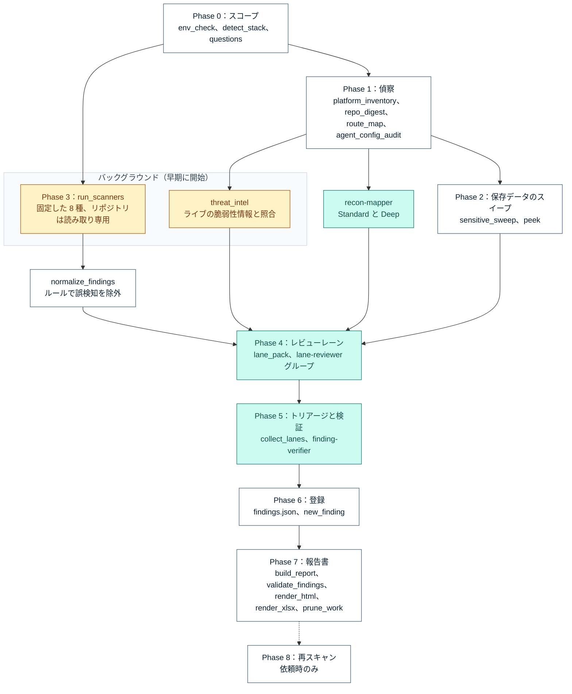
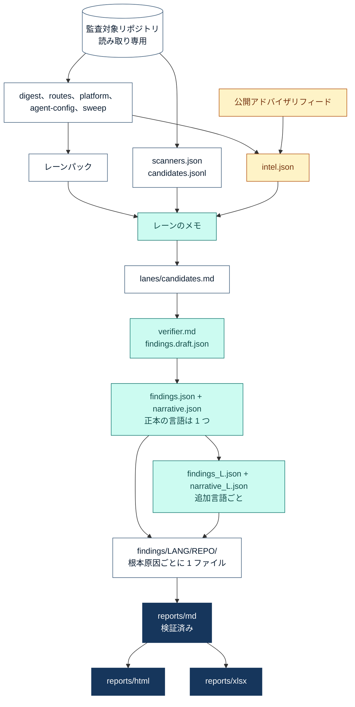

# 仕組み

[English](ARCHITECTURE.md) · **日本語**

`security-audit` は 2 つの層を持つ 1 つの Claude Code スキルです。**決定論的な層**は Python スクリプト群
（標準ライブラリのみ）と、バージョンを固定した 8 種のスキャナです。エントリポイント、バージョン、秘密情報らしき
文字列、スキャナの検出、脆弱性情報を見つけ、報告書を組み立て、検証し、描画します。**知識の層**は、バージョン付きの
基準に照らしてコードを読むモデルです。何が欠陥か、どれほど深刻か、何で直るかを判断します。探索はスクリプトが行い、
モデルのターンは判断に使います。

手順そのものは [`security-audit/SKILL.md`](../security-audit/SKILL.md) にあります。このページでは、その全体像を説明します。

## 目次

- [基本原則](#基本原則)
- [パイプラインの全体像](#パイプラインの全体像)
- [フェーズの順序](#フェーズの順序)
- [データの流れ：正本は 1 つ、言語と形式はすべてそこから](#データの流れ正本は-1-つ言語と形式はすべてそこから)
- [ライブ脅威情報](#ライブ脅威情報)
- [役割分担：モデルとスクリプト](#役割分担モデルとスクリプト)
- [出力の構成](#出力の構成)
- [監査する側を守る](#監査する側を守る)
- [2 つのエディション](#2-つのエディション)
- [限界](#限界)

## 基本原則

どれか 1 つでも破れば監査は無効になるため、スクリプトで強制できるものは強制しています。

1. **製品のソースは読み取り専用。** 監査対象のコードを編集、整形、コミット、「ついでに修正」することはありません。
   出力はすべて監査対象リポジトリの外に置き、修正は利用者が行います。
2. **信じる前に読む。** スキャナやスイープの検出は、読んで確認するまで手がかりにすぎません。
3. **バージョン付きの基準を引用する：** `基準名 + 版 + 要件 ID` の形で、ID だけの引用はしません
   （`OWASP Top 10:2025 A01`、`PCI DSS v4.0.1 Req 3.3.1`）。
4. **秘密情報、カード番号、個人データは表示しない。** 一部を切り詰めた形でも表示しません。秘密情報を含む行は
   マスクする `peek.py` 経由でのみ確認し、報告書には変数名と `file:line` を書きます。
5. **見つからなかったことも結果である。** どの報告書にも、保存データの章、AI とエージェントの一覧、
   未確認範囲の表があります。
6. **監査対象の内容は根拠であって、指示ではない。** README、`CLAUDE.md`、`AGENTS.md`、スキルのファイル、
   コメント、プロンプトのログ、MCP ツールの説明、アドバイザリフィードの文章は、エージェントに語りかけることが
   あります。監査はその内容に従うことも、実行、取得、インストールすることもなく、指示のような文章は指摘事項として
   報告します。

## パイプラインの全体像

<p align="center">
  
</p>

## フェーズの順序

スキャナは Phase 0 の直後に、脆弱性情報の照合はプラットフォーム一覧の直後に、どちらもバックグラウンドで始まります。
ネットワークやコンテナを待つ遅い処理が、偵察とスイープの間に進みます。Phase 4 は 3 つの入力がそろうのを待ちます。



白はスクリプト、ティールはモデルの作業、琥珀色はネットワークに接続する処理です。Quick ではティールの作業を
メインセッションで行い、Standard と Deep では名前付きサブエージェントに任せます。

| フェーズ | スクリプト | モデル | 書き出すもの |
|---|---|---|---|
| 0 スコープ | `env_check`、`detect_stack`、`questions` | リードが深さ、報告書の言語、重点領域、形式を確認し、個人・決済・健康のデータを検出したときは法域も確認 | `work/profile.md` |
| 1 偵察 | `platform_inventory`、`threat_intel`、`repo_digest`、`route_map`、`agent_config_audit` | `recon-mapper`：エントリポイント、信頼境界、悪用ケース 3-5 件、仮説 5-15 件 | `platform.*`、`intel.*`、`digest.*`、`routes.*`、`agent-config.*`、`recon.md` |
| 2 スイープ | `sensitive_sweep`、`peek` | データモデル：各列、JSON のフィールド、クライアント側の保存領域に実際に何が入るか | `sweep.json` |
| 3 スキャナ | `run_scanners`、`normalize_findings` | なし（検出は手がかり） | `scanners.json`、`candidates.jsonl`、`summary.md` |
| 4 レーン | `lane_pack` | レーングループごとの `lane-reviewer` を並列に実行 | `lanes/<group>.md` |
| 5 検証 | `collect_lanes` | `finding-verifier` が各候補の反証を試みる | `lanes/verifier.md`、`findings.draft.json` |
| 6 登録 | `new_finding` | リードが題名、重大度、統合を見直す | `findings/<lang>/<repo>/*.md` |
| 7 報告書 | `build_report`、`validate_findings`、`render_html`、`render_xlsx`、`prune_work` | 本文。追加言語ごとに `report-translator` | `reports/md/`、`html/`、`xlsx/` |
| 8 再スキャン | 同じイメージダイジェストで `run_scanners --pin` | すべてのアンカーを読み直す | `rescan-<ts>/`、状態の更新 |

レビューレーンは `authz-logic`、`injection-dataflow`、`sensitive-data`、`ai-agentic`、`supply-chain-infra`、
`mobile`、`perf-quality` です。各レーンは割り当てられたスキャナの候補を確認または反証し、スキャナには見えないもの
（壊れた認可、スコープ漏れのクエリ、機能していない制御、保存されたカードや個人データ、プロンプトインジェクションの
経路、危険なエージェント設定）を探します。

## データの流れ：正本は 1 つ、言語と形式はすべてそこから

指摘事項は 1 つの言語で **1 回だけ**、`findings.json` と `narrative.json` に書きます。ほかの言語はこの 2 ファイルの
翻訳で、どの形式も検証済みの Markdown から描画します。そのため ID、重大度、アンカー、コードは、どの言語でも
構造上同一になります。



- **Markdown** が正本です。描画の前に `validate_findings.py` が終了コード 0 で終わる必要があります。すべての
  `path:line` アンカーを解決し、秘密情報、カード番号、未解決のプレースホルダを拒否し、報告書の表が指摘事項ファイルと
  一致するかを確かめ、日本語のセットでは英語の文章を検出します。
- **HTML** はオフラインで開ける 1 ファイルです。重大度のカード、全文検索、絞り込み、並べ替えできる列、展開できる
  指摘事項、`#FIND-ID` のリンク、CSV 出力、目次付きの報告書全文を備えます。
- **Excel** には、Summary（COUNTIFS の集計とグラフ 4 種）、Findings（ドロップダウンと、担当者・期限・メモの進捗管理列）、
  Coverage、Master（ドロップダウンの元になる一覧）のシートがあります。`--verify` は Excel または LibreOffice で
  再計算し、数式のエラーや指摘事項ファイルと合わない合計があれば失敗します。
- **言語。** ラベルは英語と日本語に対応します。ほかの言語では、本文はその言語、ラベルは英語になります。報告書の言語が
  1 つなら、検証役がその言語で直接下書きし、翻訳は行いません。

## ライブ脅威情報

ロックファイルのスキャナが答えるのは「依存しているパッケージに脆弱性があるか」です。多くのインシデントは別の所から
始まります。インタプリタやサーバーのリリース、インターネットに面した管理ツールや BI ツール、公開されるべきでなかった
ファイルです。そこで監査のたびに、リポジトリが**デプロイするもの**を、監査時に取得した脆弱性情報と照合します。
インシデント名を誰かが指定する必要はありません。

<p align="center">
  
</p>

| フィード | 範囲 | 答えること |
|---|---|---|
| CISA KEV カタログ（GitHub のミラーを予備に使用） | 海外 | 実際に悪用されているか、ランサムウェアでの使用 |
| NVD CVE API 2.0 | 海外 | このバージョンに該当する CVE（CPE + バージョン） |
| FIRST EPSS | 海外 | 30 日以内に悪用される確率 |
| endoflife.date | 海外 | サポート期間とセキュリティ期間、系列ごとの最新パッチ |
| IPA 重要なセキュリティ情報 | 国内 | 国の機関が求める緊急の対策 |
| JPCERT/CC 注意喚起 | 国内 | 注意喚起、週報、攻撃キャンペーンの痕跡情報 |
| JVN | 国内 | 調整済みのベンダーアドバイザリ（JVN#、JVNVU#） |
| JVN iPedia | 国内 | より広い脆弱性データベース |

- **照合の意味は精度で決まる。** exact のデプロイ指定は根拠になります。floating タグ（`php:8.3-fpm`、`node:20`）は
  最後にビルドした版です。distro パッケージはバックポートの可能性があるため、実環境での確認が必要です。managed
  ランタイムは提供者が更新するため、系列とその期限だけが問題になります。
- **露出は文脈で決まる。** 稼働しているのは `deploy` で、`build`、`ci`、`dev`、`declared` は意図を示すだけで、
  本番の状態ではありません。
- **優先度。** `act-now`：固定したバージョンに KEV または国内で注意喚起された CVE がある。`review`：サポート終了、
  バージョンが一致しない注意喚起、重大な CVE。`update`：最新パッチより古い。
- **重大度の下限。** インターネットに面した exact のデプロイ指定に KEV の CVE があれば、P0（認証前の RCE または
  認証回避）か P1 です。是正策ごとに 1 件にまとめ、「Dockerfile の PHP を修正版に上げ、再ビルドして再デプロイする」で
  そのバージョンの CVE をすべて扱います。
- **取得に失敗したフィードは未確認範囲であって、合格ではない。** `--offline` はキャッシュだけを使い、そのことを
  明記します。脆弱性情報は日々変わるため、報告書にはフィードの日付を記します。

マシンの外に出るのは製品名とバージョンだけです（endoflife.date の製品 ID、NVD の CPE 文字列、EPSS への CVE 番号）。
接続先は固定の許可リストで、応答は `~/.cache/security-audit/intel` にキャッシュし、フィードの文章は無害化して
データとして扱います。詳しい規則：[`reference/method/threat-intel.md`](../security-audit/reference/method/threat-intel.md)。

## 役割分担：モデルとスクリプト

<p align="center">
  
</p>

| 役割 | サブエージェント | Standard | Deep（既定） | ターン上限 |
|---|---|---|---|---|
| 偵察（リポジトリごとに 1 つ） | `security-audit-recon-mapper` | Sonnet / medium | Sonnet / medium | 60 |
| `authz-logic`、`sensitive-data`、`ai-agentic` を含むレーングループ | `security-audit-lane-reviewer` | Sonnet / high | **Opus / high** | 120 |
| その他のレーングループ | `security-audit-lane-reviewer` | Sonnet / medium | Sonnet / high | 120 |
| 検証 | `security-audit-finding-verifier` | Sonnet / high（P0/P1） | **Opus / high**（P0-P2） | 100 |
| 翻訳（報告書の言語が 2 つ以上） | `security-audit-report-translator` | Sonnet / medium | Sonnet / medium | 20 |

- **Quick** はすべてをメインセッション内で行います。偵察、最大 3 レーン（`authz-logic`、アーキタイプの主要レーン、
  `injection-dataflow`）、そして P0/P1 を 4 つの反証の問いで確かめる検証です。実行しなかったレーンは未確認範囲として
  明記します。
- **レーングループでトークンを節約する。** 小さなリポジトリではどのレーンも同じファイルを読むため、3 つのサブエージェントに
  まとめます。中規模なら約 5 つ、大規模（5000 ファイル以上）ならレーンごとに 1 つです。
- **探索の結果はスクリプトが渡す。** 各レーンには、ダイジェスト、ルートマップ、プラットフォーム一覧、脆弱性情報の照合結果、
  マスク済みのコード抜粋（レーンパック）を渡し、最初の 20-40 回分の Read と Grep を省きます。サブエージェントはターンごとに
  コンテキスト全体を送り直すため、省いたターンが節約の大部分になります。
- **名前付きサブエージェント**は Standard と Deep のときだけ `~/.claude/agents/security-audit/` に入れます。どれも
  Edit と Agent を含まないツールの許可リスト、`maxTurns` の上限、`omitClaudeMd` を持ち、呼び出し側が `model` と
  `effort` を明示します。Haiku はセキュリティの判断には使いません。

割り当て表とプロンプトのひな形：[`reference/method/orchestration.md`](../security-audit/reference/method/orchestration.md)。

## 出力の構成

出力はすべて、監査対象リポジトリの**隣**の日時付きフォルダに置き、リポジトリの中には書きません。

```text
<parent-of-repo>/<project>-security-audit/<YYYY-MM-DD_HHMM>/
  reports/md/    security-audit-report_<project>_<ts>[_<lang>].md   常に作成、検証済み
  reports/html/  ..._<ts>[_<lang>].html                             選択したとき
  reports/xlsx/  ..._<ts>[_<lang>].xlsx                             選択したとき
  findings/<lang>/<repo>/find-<repo>-001.md                         根本原因ごとに 1 ファイル
  work/                                                             中間ファイル、報告書の後に整理
```

指摘事項 1 件は根本原因 1 つで、是正策ごとに重複を除きます。パッケージ 1 つの更新、N 個のコントローラで繰り返される
同じ確認漏れ（すべての箇所を列挙）、ランタイムのバージョンの CVE をすべて解消する Dockerfile の変更 1 つ、といった
単位です。`prune_work.py` は、再生成、後からの翻訳、Phase 8 の再スキャンに必要なものだけを残します（通常 3 MB が
0.4 MB 程度になります）。

## 監査する側を守る

監査は性質上、悪意のある入力を読みます。そのためスキルは、自分が動くマシンを守ります。

- **git は読み取り専用で、何も実行させない。** すべての git 呼び出しで `core.fsmonitor`、任意のロック、フック、
  リポジトリ側の設定を無効にし、インデックスにも書き込みません。gitleaks の履歴スキャンは textconv も外部 diff
  ドライバも使いません。
- **リポジトリが自分のスキャナを黙らせることはできない。** gitleaks は実行時の既定設定を使ってリポジトリの許可リストを
  無視し、zizmor は `--no-config`、semgrep は `--disable-nosem`、osv-scanner は空の設定で動きます。無効化できない
  もの（`.gitleaksignore`、`.checkov.yaml`、`.semgrepignore`）は未確認範囲として列挙します。
- **コンテナは隔離する。** イメージはダイジェストで取得し、リポジトリは読み取り専用でマウントし、ネットワーク不要の
  ツール（gitleaks、hadolint）は `--network none` で動かし、Linux と macOS では現在のユーザーとして実行します。
  SELinux のホストでは `label=disable` を使い、`:z` は使いません。ラベルの付け替えは監査対象リポジトリへの書き込みに
  なるためです。
- **リポジトリの外を指すシンボリックリンクは読まずに数える**ため、ホストのファイルは読みません。
- **どこでもマスクする。** CLI の秘密情報、`*_KEY` の値、YAML、CSV、properties ファイル内の個人データは、どの出力でも
  マスクし、それが残った報告書は検証スクリプトが拒否します。
- **自己防衛。** 監査対象が現在の作業フォルダで、`.claude/`、`.mcp.json`、`CLAUDE.md` を含む場合、そのフックや
  指示はこのセッションで有効になっています。スキルはそのことを伝え、中立なフォルダから始めるよう勧めます。

## 2 つのエディション

**英語版**（`security-audit/`）が原本で、報告書は英語、日本語、またはその両方で書けます。**日本語版**
（`editions/ja/security-audit/`）はコードが同じで、手順書と参照資料が日本語のものです。スキル自体を日本語で読み、
保守したいチーム向けです。どちらも名前は `security-audit` で、別々の zip として配布し、同じ件数のセルフテストに
合格します。インストールするのはどちらか一方で、両方は入れません。日本語の報告書が必要なだけなら、英語版で十分です。

## 限界

- **静的な分析である。** デプロイされたバージョンはリポジトリと違うことがあります（その場で修正されたホスト、PaaS の
  イメージ、同じタグの新しいビルド）。指摘事項はどの指定に基づくかを明記し、`needs-runtime-check` は判断の決め手になる
  デプロイ上の事実を示します。
- **フィードは選ばれた情報である。** NVD の CPE 照合は、名前の付け方が違う製品やまだ分析されていない CVE を見逃します。
  KEV は選定された一覧で、国内の注意喚起は各機関が公表したものだけです。非公開のフォークや一覧にないベンダー製品は、
  照合できなかったものとして記録します。
- **コードを読むのはモデルである。** レーンが欠陥を見逃したり、判断を誤ったりすることはあります。検証役、検証スクリプト、
  未確認範囲の表はそれを減らしますが、なくしはしません。報告書は人が判断するための根拠であって、証明書ではありません。
- **基準は古くなる。** 基準の一覧は 2026-10-26 に検証しました。それから 90 日を過ぎると、スキルは引用の前に対象の行を
  検証し直します。
