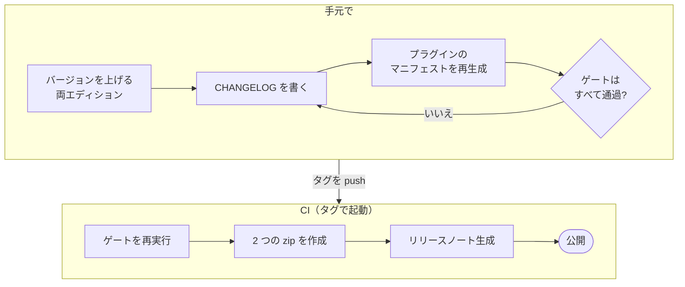

# リリース手順

[English](RELEASING.md) · **日本語**

スキルは英語版（`security-audit/`、原本）と日本語版（`editions/ja/security-audit/`）の 2 つのエディションで配布し、1 つのバージョンと 1 つのタグ `vX.Y.Z` で同時にリリースします。リリースは CHANGELOG 駆動です。GitHub のリリース本文は `scripts/release_notes.py` がスキルの CHANGELOG から生成し、手で書くことはありません。



## バージョン番号

バージョンは `1.y.z` で、メジャー番号は 1 のままです。規則は [`security-audit/CHANGELOG.md`](../security-audit/CHANGELOG.md) の冒頭にあります。

| 部分 | 上げるとき | 例 |
|---|---|---|
| `y` | 利用者が気づく新機能、出力形式、ワークフローの変更 | 新しい報告書形式、新しい言語、新しい基準モジュール |
| `z` | 修正、改善、文言、基準やスキャナのデータ更新、既存機能内の新しいチェック | マスキングの修正、新しい検索パターン、基準バージョンの再確認 |

`y` を上げたら `z` は 0 に戻します。リポジトリのバージョンはスキルのバージョンと同じです。タグ `v1.15.0` はスキル 1.15.0 をリリースします。

## バージョンが書かれている場所

| ファイル | 重要な理由 | 確認するもの |
|---|---|---|
| `security-audit/SKILL.md`（`metadata.version` とタイトル下の "Skill vX.Y.Z" 行） | インストールされたスキルが自分のバージョンを名乗る | `validate_release.py`、`package.py --check` |
| `editions/ja/security-audit/SKILL.md`（同じ 2 か所） | 日本語版も同じリリース | `validate_release.py`、`check_editions.py` |
| `security-audit/CHANGELOG.md`、`editions/ja/security-audit/CHANGELOG.md`（先頭の `## [X.Y.Z] - YYYY-MM-DD`） | リリース本文の生成元 | `validate_release.py X.Y.Z` |
| `CHANGELOG.md`（リポジトリ直下、`## vX.Y.Z`） | リポジトリのリリース内容の説明 | `validate_release.py X.Y.Z`、`package.py --check` |
| `.claude-plugin/marketplace.json`、`security-audit/.claude-plugin/plugin.json`（生成物） | `/plugin update` が読む。Claude Code は plugin.json のバージョンを優先する | `build_plugins.py --check`、`validate_release.py` |
| `eval/results/latest.json`（生成物）、`docs/numbers.json`（生成物） | README が引用する数値 | `check_numbers.py`、CI の鮮度チェック |

基準やスキャナのピンを再確認したときは、スキルの CHANGELOG の規則に従い、両エディションで `metadata.standards-verified` / `scanner-pins-verified`、`reference/standards/index.md` の表、`scripts/run_scanners.py` の `PINS_VERIFIED` も更新します。

## 手順

1. **バージョンを上げる。** 両方の `SKILL.md` の `metadata.version`、`metadata.updated`、"Skill v..." 行。
2. **CHANGELOG を書く。** 両方のスキル CHANGELOG の先頭に `## [X.Y.Z] - YYYY-MM-DD`（Keep a Changelog 形式、新しい順。Added / Changed / Fixed / Removed のうち空でないもの）。日本語版は同じ内容を日本語で書きます。次にリポジトリ直下の `CHANGELOG.md` に `## vX.Y.Z` の節を追加します。リリースページを読む人に向けて、何が変わり、なぜそれが重要かを書きます。Fixed の項目は修正内容ではなく、どんな不具合だったかを書きます。em ダッシュは使いません。
3. **生成物を再生成する。**

   ```bash
   python scripts/build_plugins.py
   python eval/run_eval.py
   python scripts/check_numbers.py --write
   ```

4. **ゲートを実行する。** すべて通過する必要があります。

   ```bash
   python scripts/validate_release.py X.Y.Z
   python scripts/package.py --version X.Y.Z --check
   python scripts/check_editions.py
   python scripts/build_plugins.py --check
   python scripts/check_numbers.py
   python scripts/check_mermaid.py
   python scripts/check_svg.py
   python scripts/release_notes.py X.Y.Z
   ```

   zip を手元で確認したいときは `python scripts/package.py --version X.Y.Z` で `dist/` に作成できます。CI は自分で作成します。
5. **予行演習（任意）。** `release` ワークフローをバージョンを指定して手動実行（workflow_dispatch）します。すべてのゲートを実行して成果物を作成しますが、何も公開しません。
6. **タグを付けて push する。**

   ```bash
   git tag -a vX.Y.Z -m "vX.Y.Z"
   git push origin vX.Y.Z
   ```

7. **CI が公開する。** `release` ワークフローがゲート（validate_release、package の事前確認、プラグインのマニフェストとアイコン、オフライン評価のフル実行、check_numbers）を再実行し、2 つの zip を作成し、`release_notes.py` で本文を生成して公開します。添付物は `security-audit-X.Y.Z.zip`、`security-audit-ja-X.Y.Z.zip`、それぞれのバージョンなし別名、`SHA256SUMS`、`eval-results.json` と `.md`、そしてタグ時点に `benchmark/RESULTS.md` と `benchmark/results/results.json` があれば `benchmark-results.md` / `.json` です。
8. **公開内容を確認する:** `gh release view vX.Y.Z --json assets -q '.assets[].name'`。

ライブベンチマーク（`benchmark/bench.py`）はリリースのゲートに含みません。費用がかかり、Claude が必要だからです。コストや再現率が変わりうる変更のときに再実行し、結果をタグの前にコミットします。

## 何がこれを保証するか

| 規則 | 保証するもの |
|---|---|
| 両エディションの `metadata.version` と CHANGELOG の最新項目がタグと一致する | `validate_release.py X.Y.Z`（リリースのゲート） |
| エディション同士、プラグインのマニフェストとも一致する（push のたびに） | `validate_release.py`、`build_plugins.py --check`（`ci.yml`） |
| 日本語版が同じコードである | `check_editions.py`（`ci.yml` と `run_eval.py` の中） |
| リポジトリ直下の `CHANGELOG.md` に `## vX.Y.Z` の節がある | `package.py --check`、`validate_release.py X.Y.Z` |
| どの zip もルートは `security-audit/` だけで、正しい `VERSION` があり、`tests/` を含まない | `package.py` が作成物を自分で検証 |
| リリース本文は CHANGELOG から作る | `release_notes.py`。どちらかのエディションに項目がなければ非 0 で終了 |
| em ダッシュも CRLF もない | `validate_release.py` |
| README の数値がこのコミットのコードと評価に一致する | `run_eval.py` の後の `check_numbers.py` |
| 再実行しても既存のリリースで失敗しない | `gh release edit` と `gh release upload --clobber` |

## リリースの取り下げ

```bash
gh release delete vX.Y.Z --yes --cleanup-tag
```

その後、理由を添えて両方のスキル CHANGELOG の **Removed** に記録します。
