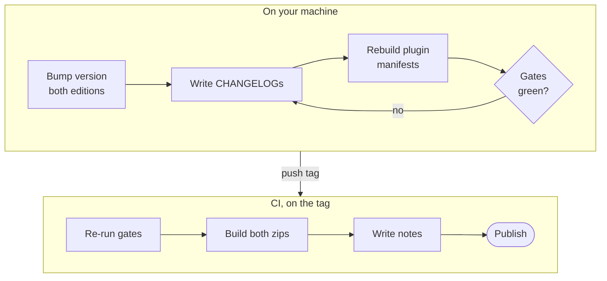

# Releasing

**English** · [日本語](RELEASING.ja.md)

The skill ships in two editions, English (`security-audit/`, the master) and Japanese
(`editions/ja/security-audit/`), released together under one version and one tag, `vX.Y.Z`. The
release is CHANGELOG-driven: the GitHub release body is generated from the skill CHANGELOG by
`scripts/release_notes.py`, never typed by hand.



## Version numbers

Versions are `1.y.z`; the major number stays 1. The rules are at the top of
[`security-audit/CHANGELOG.md`](../security-audit/CHANGELOG.md):

| Part | Bump when | Examples |
|---|---|---|
| `y` | A new capability, output format or workflow change that users notice | a new report format, a new language, a new standards module |
| `z` | Fixes, refinements, wording, standards or scanner data updates, new checks inside an existing capability | a redaction fix, a new sweep pattern, re-verified standard versions |

Reset `z` to 0 when `y` increases. The repository version is the skill version: tag `v1.15.0`
releases skill 1.15.0.

## Where the version lives

| File | Why it matters | Checked by |
|---|---|---|
| `security-audit/SKILL.md` (`metadata.version`, and the "Skill vX.Y.Z" line under the title) | An installed skill identifies itself | `validate_release.py`, `package.py --check` |
| `editions/ja/security-audit/SKILL.md` (same two places) | The Japanese edition is the same release | `validate_release.py`, `check_editions.py` |
| `security-audit/CHANGELOG.md`, `editions/ja/security-audit/CHANGELOG.md` (`## [X.Y.Z] - YYYY-MM-DD` at the top) | The release body is generated from it | `validate_release.py X.Y.Z` |
| `CHANGELOG.md` (repo root, `## vX.Y.Z`) | The narrative of what the repository release contains | `validate_release.py X.Y.Z`, `package.py --check` |
| `.claude-plugin/marketplace.json`, `security-audit/.claude-plugin/plugin.json` (generated) | `/plugin update` reads these; Claude Code prefers plugin.json's version | `build_plugins.py --check`, `validate_release.py` |
| `eval/results/latest.json` (generated), `docs/numbers.json` (generated) | Figures the README quotes | `check_numbers.py`, CI's freshness check |

When standards or scanner pins are re-verified, the skill CHANGELOG's rules also apply:
`metadata.standards-verified` / `scanner-pins-verified`, the table in
`reference/standards/index.md` and `PINS_VERIFIED` in `scripts/run_scanners.py`, in both editions.

## Procedure

1. **Bump the version** in both `SKILL.md` files (`metadata.version`, `metadata.updated` and the
   "Skill v..." line).
2. **Write the CHANGELOG entries.** `## [X.Y.Z] - YYYY-MM-DD` at the top of both skill CHANGELOGs
   (Keep a Changelog, newest first; Added / Changed / Fixed / Removed, omitting empty ones), the
   Japanese one in Japanese with the same content. Then a `## vX.Y.Z` section in the root
   `CHANGELOG.md`. Write for the person on the release page: what changed and why it matters to
   them. A Fixed entry names the failure mode, not the patch. No em-dashes.
3. **Regenerate the generated files:**

   ```bash
   python scripts/build_plugins.py
   python eval/run_eval.py
   python scripts/check_numbers.py --write
   ```

4. **Run the gates.** All must pass:

   ```bash
   python scripts/validate_release.py X.Y.Z
   python scripts/package.py --version X.Y.Z --check
   python scripts/check_editions.py
   python scripts/build_plugins.py --check
   python scripts/check_numbers.py
   python scripts/check_mermaid.py
   python scripts/check_svg.py
   python scripts/release_notes.py X.Y.Z
   ```

   `python scripts/package.py --version X.Y.Z` builds the zips into `dist/` locally if you want to
   inspect them; CI builds its own.
5. **Rehearse (optional).** Run the `release` workflow by hand (workflow_dispatch) with the version:
   it runs every gate and builds every artifact, and publishes nothing.
6. **Tag and push.**

   ```bash
   git tag -a vX.Y.Z -m "vX.Y.Z"
   git push origin vX.Y.Z
   ```

7. **CI publishes.** The `release` workflow re-runs the gates (validate_release, package preflight,
   plugin manifests and icon, the full offline eval, check_numbers), builds both zips, generates the
   body with `release_notes.py`, and publishes with these assets: `security-audit-X.Y.Z.zip`,
   `security-audit-ja-X.Y.Z.zip`, their unversioned aliases, `SHA256SUMS`, `eval-results.json` and
   `.md`, and `benchmark-results.md` / `.json` when `benchmark/RESULTS.md` and
   `benchmark/results/results.json` exist at the tag.
8. **Check what was published:** `gh release view vX.Y.Z --json assets -q '.assets[].name'`.

The live benchmark (`benchmark/bench.py`) is not part of the release gates: it costs money and
needs Claude. Re-run it when a change could move cost or recall, and commit its results before the
tag.

## What enforces this

| Rule | Enforced by |
|---|---|
| Both editions' `metadata.version` and newest CHANGELOG entry equal the tag | `validate_release.py X.Y.Z` (release gate) |
| The editions agree with each other and with the plugin manifests, on every push | `validate_release.py`, `build_plugins.py --check` (`ci.yml`) |
| The Japanese edition is the same code | `check_editions.py` (`ci.yml`, and inside `run_eval.py`) |
| The root `CHANGELOG.md` has a `## vX.Y.Z` section | `package.py --check`, `validate_release.py X.Y.Z` |
| Every archive has only `security-audit/` at its root, a correct `VERSION`, no `tests/` | `package.py` verifies what it built |
| The release body comes from the CHANGELOG | `release_notes.py`; exits non-zero when either edition lacks the entry |
| No em-dash, no CRLF | `validate_release.py` |
| The README figures match the code and the eval of this commit | `check_numbers.py` after `run_eval.py` |
| A re-run does not fail on an existing release | `gh release edit` and `gh release upload --clobber` |

## Withdrawing a release

```bash
gh release delete vX.Y.Z --yes --cleanup-tag
```

Then record it, with the reason, under **Removed** in both skill CHANGELOGs.
